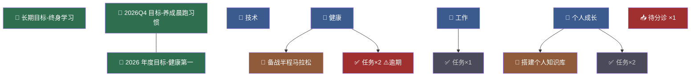

# 🗺️ Atlas — 全局拓扑

> ⚠️ 生成文件，勿手改。运行 `uv run scripts/gen_atlas.py` 或触发 AI 分诊（/sb-triage）时重建。
> 数据流：🎯 目标 → 📂 领域 → 🚀 项目 → ✅ 任务簇（聚合计数）。红色 = 含逾期任务的簇 / 活跃项目下游 / 待分诊积压。

## 拓扑

## 体检摘要 · 2026-11-20 15:51

| 指标 | 值 |
|------|-----|
| 活跃目标 | 3 |
| 领域（含子领域） | 4 |
| 活跃项目 | 2 |
| 开放任务 | 7（逾期 1） |
| 待分诊（无领域/项目） | 1 |

